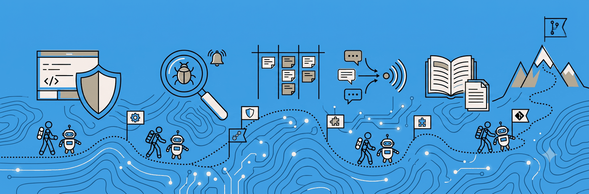

  

<b>Building AI-native systems where agents own the work, and I stay the editor.</b>

# Hi, I'm Javier Feliu 👋

**Engineering Manager & Senior Full-Stack Engineer** based in Panama City. I lead a 10-person engineering team at a private ad tech company, splitting my time between hands-on building and leadership. I've shipped high-performance, scalable systems for years, and increasingly I build the AI systems that let a small team deliver like a much larger one.

The thread through my whole career is simpler than any stack:

> **If we're doing something manually, that's a bug, so fix it.**

A mentor framed it that way years ago, and it stuck. I spent over a year leading process-automation efforts: Airflow pipelines and Chrome extensions that wired internal systems into platforms like Notion, Salesforce, and Linear, turning manual toil into software that ran itself. Back then, LLMs were too early to lean on. Now they're genuinely capable and expert at tool use, which makes that principle *more* true than ever: a far larger share of real work can be owned by software, with far less effort. That's what I build now.

## 🧩 Four kinds of AI work I build, and measure

- **Chat over your own content that says "not covered" instead of making things up.** Hybrid keyword and vector search in PostgreSQL, reranking, a relevance floor, and citations the server verifies. Recall@1 went from 7.5% to 87.5%; on a 221-question test set it answered all 190 covered questions and declined 30 of the 31 it shouldn't answer, at about $0.0017 per answer. *(Panama in Context)*
- **Messy inputs into clean records.** WhatsApp messages, voice notes, photos and lab PDFs become structured rows: a cheap model triaged 886 files for $0.32, a strong one extracted 113 lab reports with 2,103 results for $8.76, code validates every value, and anything uncertain goes to review. *(AI Care Companion)*
- **Safe agent access over MCP.** An MCP server inside an existing FastAPI app: 16 tools across 3 permission scopes, hashed tokens, an audit row per call, and approval requests for anything risky, so no agent publishes on its own. The content automation went from 29 production SQL statements per batch to none. *(Panama in Context)*
- **Multi-step AI pipelines with quality gates.** Research before writing, claim-by-claim fact-checking (13,762 claims checked, 780 corrected), a meaning check on every editor change, and a person approving what ships. The same rule drives record updates: the AI proposes, a person approves (316 suggestions so far, 296 approved). *(Panama in Context, AI Care Companion)*

Underneath all four: the cheapest model that passes the test set, hard daily budgets with an off switch, and malformed or cut-off model output treated as a failure, never as an answer.

## 🏭 What I build and run in production

**[Panama in Context](https://github.com/wanderindev/ai-powered-content-generation-engine): the platform for a Panama tour and school field-trip business.**
I built it and run it. One topic suggestion fans out through parallel AI pipelines into researched, fact-checked articles in English and Spanish, narrated lesson videos, study guides, and social posts, with a human approving at every gate. It also carries the MCP server above, and the chat-over-content assistant, measured on the 221-question set and held back from public launch for now. Claude Opus, Sonnet and Haiku routed by task, Gemini for image generation, DeepL translation, ElevenLabs narration, and a from-scratch narrated-video pipeline (Chromium to ffmpeg). FastAPI · React · PostgreSQL · pgvector. [Write-up](https://feliu.dev/projects/panama-in-context)

**[AI Care Companion](https://github.com/wanderindev/ai-care-companion): a health-record app in daily use by a small family care team.**
Siblings sharing the care of two elderly parents use it every day, and they send feature requests and bug reports that I ship like any client's. A Chrome extension syncs the family's WhatsApp group; voice notes are transcribed, lab PDFs are classified and read, and a daily analysis proposes visit-log entries, appointments and medication changes that a person approves. A chat grounded in the record writes the summary a new specialist needs. From design doc to production in a week. FastAPI · React · PostgreSQL. [Write-up](https://feliu.dev/projects/ai-care-companion)

## 🛠️ Tools I built around them

**[Managed Agents](https://github.com/wanderindev/managed-agents): agents that work while I sleep.**
A durable-log orchestrator that runs Claude Code in disposable Docker sandboxes on a DigitalOcean droplet. It picks up production Sentry issues, investigates them against the real code, writes a test that fails before the fix and passes after, and opens a draft PR. Every fix is then attacked by a fresh-context adversarial reviewer that has to fail to refute it before the PR leaves draft. A nightly job audits each repo's memory file against what the week's runs actually established, and a driver works the content pipeline's task queue. Nothing merges without me. Python · PostgreSQL · Docker · GitHub App · Sentry.

**[Agent Ready](https://github.com/wanderindev/agent-ready): making an existing codebase safe to hand to agents.**
A Claude Code plugin marketplace that walks a project through the whole pipeline: bootstrap the repo for agent work, audit it area by area into a labeled and agent-classified backlog, then resolve that backlog autonomously where the audit proved the work tractable and in pair-mode where judgment is load-bearing. A companion guardrails plugin installs the safety floor: destructive actions denied, production gated, secrets protected. Extracted from a real audit-to-autonomy run on a fast-grown production codebase: 138 issues closed and 165 PRs merged.

**[PIC Companion](https://github.com/wanderindev/research-companion-extension): an API around a tool that doesn't have one.**
A Chrome extension that drives Claude's deep-research mode unattended, turning a browser UI into an automation surface that feeds the content pipeline.

## 🤖 How I work with AI

I don't treat AI as a helper bolted onto a human-paced process. I build the **leverage** that lets agents own whole workflows: the skills, context, guardrails, and self-verifying checks. I keep humans in the loop where judgment matters, and nothing ships open-loop.

I'm currently leading my team's AI-adoption effort: moving us from "AI writes code faster" to AI woven across the core workflows we run every day, safely and with shared tooling and guardrails, so the whole team's ceiling rises, not just mine. In practice that means wiring models into the systems the work already lives in, over MCP and APIs: Sentry, Linear, Notion, Bitbucket, Google Ad Manager, and our own services, so an agent can pick up a ticket, root-cause it against the codebase, and open the PR without a human relaying context between tools.

## 🧰 Areas of Expertise

- **AI-Native Engineering**  
  RAG with hybrid search and abstention, document extraction, MCP servers, agentic pipelines with human approval gates, Claude models routed by task alongside Gemini for image work, closed-loop verification with adversarial review, durable run logs that survive a killed sandbox, cost controls, and prompt / context / skill design.

- **Distributed Systems & Performance**  
  Ultra-low-latency APIs with sub-50ms response times across multiple AWS regions, using intelligent caching and cross-region deployment for fraud-detection and ad-tech workloads.

- **Edge Computing & CDN**  
  CloudFront edge functions and KeyValueStore solutions for real-time request filtering and access control, at sub-millisecond performance across thousands of domains.

- **Process Automation & Orchestration**  
  Airflow workflows automating business processes, onboarding, and infrastructure updates; Chrome extensions with distributed task execution across third-party platforms.

- **Full-Stack Development**  
  FastAPI, Flask, Django, React, Express, PostgreSQL (with pgvector), and Redis, plus Docker and cloud infrastructure (AWS, DigitalOcean, CloudFront). I stand it up, ship it, and run it.

- **Infrastructure & DevOps**  
  Self-hosted Sentry for production monitoring, major Jenkins CI/CD overhauls, declarative pipelines, and build optimization.

## 👋 Let's connect

🌐 [feliu.dev](https://feliu.dev) &nbsp;·&nbsp; 💼 [LinkedIn](https://www.linkedin.com/in/javierfeliu/)
